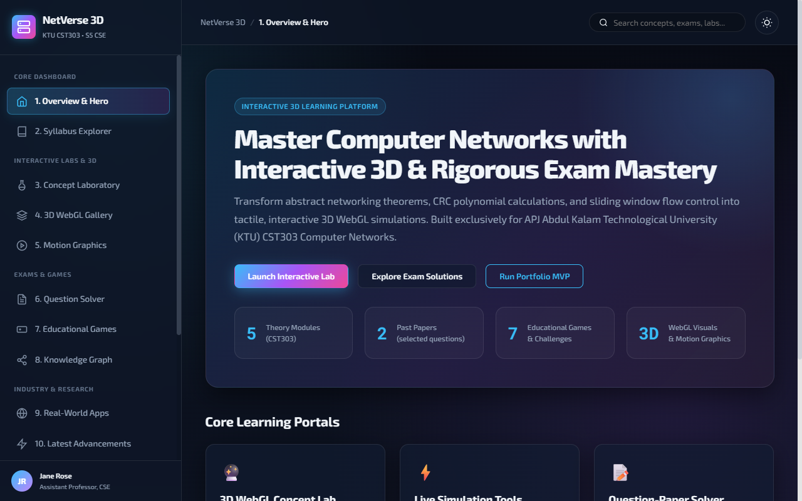
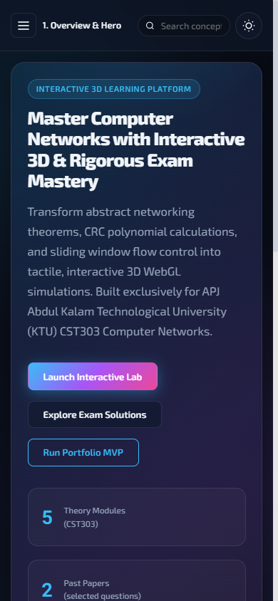
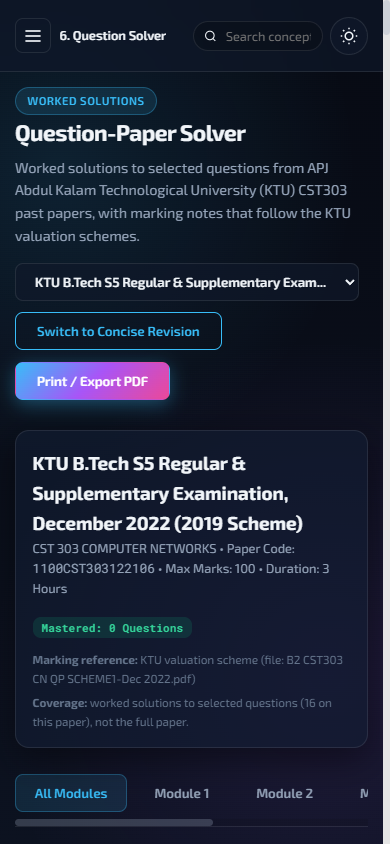
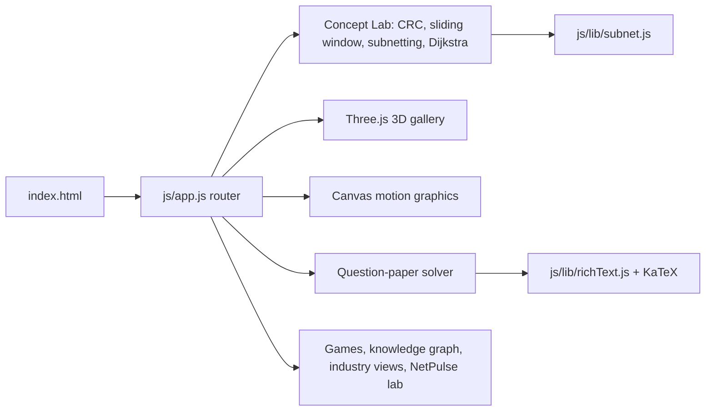

# NetVerse 3D: an interactive 3D learning dashboard for KTU CST303 Computer Networks

[](https://creativecommons.org/licenses/by-nc-nd/4.0/)
[](https://cst303-computer-networks-dashboard.vercel.app)

## Overview

NetVerse 3D is a static web app I built for teaching CST303 Computer Networks (APJ Abdul Kalam Technological University, B.Tech CSE, 2019 scheme). It turns syllabus topics into things students can operate: protocol simulators, orbitable 3D scenes, animated mechanisms, games and worked past-paper solutions. It runs in any modern browser with no build step and no backend.

## Demo

Live: https://cst303-computer-networks-dashboard.vercel.app

| Overview, 1280 px | Overview, 390 px | Worked solution with rendered maths, 390 px |
|---|---|---|
|  |  |  |

## Problem statement

Computer networks courses lean on diagrams and hand calculations (CRC division, sliding windows, subnetting, shortest paths). Students get the answer without seeing the mechanism. This dashboard lets them change the inputs and watch the mechanism run.

## Approach

A single-page app (`index.html`) with a small view router (`js/app.js`) and one ES module per feature. Everything is computed in the browser.



The 15 views are:

1. **Overview**: entry page with quick links.
2. **Syllabus Explorer**: Modules 1 to 5 and the PCCSL507 lab, browsable by topic.
3. **Concept Laboratory**:
   - CRC generator and verifier (modulo-2 division, step by step)
   - Sliding window simulator (Stop-and-Wait, Go-Back-N, Selective Repeat) with frame loss and timeout
   - IPv4 subnetting and CIDR calculator
   - Dijkstra shortest-path router on a 6-node graph
4. **3D WebGL Gallery** (Three.js): topologies, optical-fibre total internal reflection, OSI encapsulation, OSPF areas, datagram versus virtual circuit.
5. **Motion Graphics** (Canvas): token bucket, TCP AIMD, ARP, DNS.
6. **Question Solver**: worked solutions to all 30 questions of each of the December 2022 and December 2023 papers (10 in Part A and 20 in Part B), with a concise/detailed toggle, marking notes that follow the KTU valuation schemes, a mastery checklist stored in `localStorage` and a print view.
7. **Educational Games**: seven games (A to G).
8. **Knowledge Graph**: force-directed map of protocols and concepts.
9. **Real-World Apps**, 10. **Latest Advancements**, 11. **Research Explorer**: case studies, recent developments and cited papers with DOIs.
12. **Industry Tools**, 13. **Career & Salary**: tools used in practice and indicative salary ranges (not independently verified).
14. **NetPulse**: a simulated SDN topology with packet injection, link failure and generated Cisco IOS configuration.
15. **References**: textbooks and RFCs.

### Subnetting maths

The calculator reports the address class from the first octet and measures "bits borrowed" against that class's default mask (A /8, B /16, C /24). A prefix shorter than the default is shown as a supernet; Class D and E addresses have no default mask, so the field reads "not applicable". The maths lives in `js/lib/subnet.js` and is covered by unit tests.

## Data

- **Syllabus, solutions and research data**: hand-written data files in `js/data/` (`syllabusData.js`, `examSolutionsData.js`, `industryResearchData.js`, `careerData.js`).
- **Past-paper coverage is complete**: worked solutions for 30 of 30 questions on each of the December 2022 and December 2023 papers (10 Part A questions and 20 Part B sub-questions each; in the exam a student answers one question from each module's pair). The counters in the app are computed from `examSolutionsData.js`, not typed by hand.
- **Numerical answers are machine-checked**: `scripts/verify_solutions.js` recomputes every numerical or algorithmic result (propagation delay, CRC, parity, subnetting, bit and byte stuffing, Manchester codes, the distance vector and Dijkstra examples, header and frame sizes, multicast address mapping) and checks that the value appears in the written solution. Theory answers follow standard textbooks and are listed with a confidence level in `docs/review-checklist.md`.
- **Salary ranges** are indicative. Each card names its sources (AmbitionBox, Glassdoor, Payscale and others), but the figures are not linked to the underlying reports and have not been independently verified.
- **NetPulse telemetry** (latency, drops) is simulated.
- **Reference PDFs** in `docs/reference_materials/` are third-party documents. See `THIRD_PARTY_NOTICES.md`.
- **Privacy**: no accounts, no analytics, no network calls other than loading the libraries and fonts below. The only stored data is the theme and the mastery checklist, in the visitor's own browser.

## Results

| Check | Value | Status | How measured | Date |
|---|---|---|---|---|
| Unit tests (`node --test`) | 30 of 30 pass | Verified (re-run 2026-10-14) | `node --test`, Node v22.20.0 | 2026-10-14 |
| Numerical answers in worked solutions | 86 of 86 checks pass | Verified (re-run 2026-10-14) | `npm run verify` (`scripts/verify_solutions.js`) | 2026-10-14 |
| Past-paper coverage | 30 of 30 questions on each of 2 papers | Verified (re-run 2026-10-14) | `npm run verify`, counted from `examSolutionsData.js` | 2026-10-14 |
| Worked solutions render in the browser | 60 solution cards, 0 KaTeX errors, 0 literal `$` | Verified (re-run 2026-10-14) | Playwright, both papers at 390 px and 1280 px | 2026-10-14 |
| Horizontal overflow, 15 views at 390 px | 0 px on all views | Verified (re-run 2026-10-14) | Playwright, `scrollWidth - clientWidth` | 2026-10-13 |
| Horizontal overflow, 15 views at 1280 px | 0 px on all views | Verified (re-run 2026-10-14) | Playwright, same method | 2026-10-13 |
| Console errors on load and navigation | 0 (only a missing `favicon.ico`) | Verified (re-run 2026-10-14) | Playwright console listener | 2026-10-13 |

Run logs: `docs/runs/2026-10-13-tests-and-mobile-checks.md` and `docs/runs/2026-10-14-complete-past-paper-solutions.md`.

## Tech stack

- HTML5, CSS3 (custom glass-style design system), vanilla JavaScript ES modules
- [Three.js](https://threejs.org/) r128 for 3D, HTML5 Canvas for 2D animation
- [KaTeX](https://katex.org/) 0.16.11 for maths in worked solutions
- Google Fonts: Exo 2 and Roboto Mono
- Node's built-in test runner (`node --test`) for unit tests
- Hosted on Vercel as a static site

## Getting started

Prerequisites:

- A modern browser with WebGL (Chrome, Edge, Firefox or Safari)
- Python 3 or Node.js 20 or later, to serve the files (ES modules do not load from `file://`)
- An internet connection, because Three.js, KaTeX and the fonts load from a CDN

```bash
git clone https://github.com/Janeferdinant/cst303-computer-networks-dashboard.git
cd cst303-computer-networks-dashboard

# serve the site (either one)
python -m http.server 8090
# or
npx serve -l 8090 .
```

Open http://localhost:8090. Expected: the Overview page loads with the "Interactive 3D Learning Platform" badge, and the browser console shows no errors.

Run the tests (no install step, there are no dependencies):

```bash
node --test
```

Expected: `# tests 30`, `# pass 30`, `# fail 0`.

Recompute and check every numerical answer in the worked solutions:

```bash
npm run verify
```

Expected: `86/86 numeric checks passed`, then `coverage cst303-dec2022: 30/30` and `coverage cst303-dec2023: 30/30`.

## Project structure

```
cst303-computer-networks-dashboard/
├── index.html                  # single-page entry point
├── css/style.css               # design system and responsive rules
├── js/
│   ├── app.js                  # view router, theme, mobile menu
│   ├── lib/
│   │   ├── subnet.js           # subnetting maths (unit-tested)
│   │   ├── coverage.js         # past-paper coverage counters (unit-tested)
│   │   └── richText.js         # Markdown + TeX renderer (unit-tested)
│   ├── data/                   # syllabus, worked solutions, research, careers
│   └── modules/                # one module per feature
├── scripts/
│   └── verify_solutions.js     # recomputes every numerical answer in the worked solutions
├── tests/                      # node --test unit tests
├── docs/
│   ├── reference_materials/    # third-party PDFs (see THIRD_PARTY_NOTICES.md)
│   ├── review-checklist.md     # every new solution with a confidence level
│   ├── runs/                   # dated run logs
│   ├── screenshots/
│   └── superpowers/plans/      # original implementation plan
├── package.json                # test and verify scripts, no dependencies
├── LICENSE
└── THIRD_PARTY_NOTICES.md
```

## Real-world applications

- A revision aid and classroom demonstrator for CST303 and similar networking courses.
- The NetPulse view shows how a topology simulator and generated router configuration can support a Packet Tracer or GNS3 lab.

## Limitations

- Theory answers (as opposed to the numerical ones) cannot be machine-checked. They are model answers in exam-answer form from standard textbooks, not an official KTU answer key, and their review status is in `docs/review-checklist.md`.
- Salary figures are indicative and unverified; NetPulse telemetry is simulated.
- The subnet tool accepts prefixes /1 to /30 and uses classful defaults only to report bits borrowed.
- Libraries load from a CDN, so the app needs a connection.
- No automated browser tests are committed; the layout checks in the run log were run by hand with Playwright.
- The 3D gallery needs WebGL.

## Future scope

- More past papers (the December 2021 and 2024 papers are in `docs/reference_materials/` but have no worked solutions).
- Source links and dates for the salary ranges.
- Committed Playwright smoke tests.
- Bundling the libraries locally so the app works offline.

## Credits & citation

- Course: KTU CST303 Computer Networks (2019 scheme) and PCCSL507 Networks Laboratory. Past papers and valuation schemes are KTU documents.
- Libraries: Three.js (MIT), KaTeX (MIT), Google Fonts.
- Third-party material and its status: `THIRD_PARTY_NOTICES.md`.

## License

Original work © Jane Rose Ferdinant, licensed CC BY-NC-ND 4.0. Third-party components retain their own licenses; see THIRD_PARTY_NOTICES.md.

## Author

Jane Rose Ferdinant, Assistant Professor, Department of Computer Science and Engineering.

- Portfolio: https://janeferdinant.vercel.app
- LinkedIn: https://www.linkedin.com/in/janerosenf/
